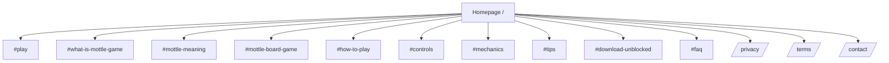

# mottlegame.cc 网站设计、URL 与 SEO 规格

状态：设计规格 v2  
日期：2026-11-15  
站点：`https://mottlegame.cc/`  
交付类型：双语游戏首页、实测攻略和必要站点页面  
参考上下文：[PRODUCT.md](../PRODUCT.md)、[11 个内容分块与验收](./mottlegame.cc-one-page-content-blocks-and-acceptance.md)、[原版试玩记录](./playtest-notes.md)

## 双语 URL 与实测内容

此版保留英文首页的 11 个分块，在独立 URL 提供完整简体中文版本，以及有来源、取证日期和实测范围的图文攻略。下表优先于早期仅英文的规划。

| 功能 | 英文 | 简体中文 | 搜索意图 |
| --- | --- | --- | --- |
| 试玩主页 | `/` | `/zh/` | 在线游戏、mottle meaning、桌游辨别、操作 |
| 图文攻略 | `/play-guide/` | `/zh/play-guide/` | 机制实测、回合记录、进阶路线和高分策略 |
| 隐私 | `/privacy/` | `/zh/privacy/` | 第三方 iframe 和数据处理 |
| 条款 | `/terms/` | `/zh/terms/` | 站点、游戏归属和指南范围 |
| 联系 | `/contact/` | `/zh/contact/` | 反馈、原始作品 |

- 每对语言页面使用各自的 canonical 和互相可验证的 `en`、`zh-Hans`、`x-default`。英文为默认版。页眉语言链接跳到对应页面。
- 英文游戏名采用原作页的 Mottle — Hide & Seek。中文指南称《变色龙：躲猫猫》。原作画面保留嵌入源实际显示的语言。
- 首页回答短问题，攻略承担完整图文教程、挑战日志和复测步骤。分数写明是哪一局和哪个回合，敌人表现与开发者算法分开表述。
- 初始 HTML 输出正文、可见证据和图片说明，生成 `WebSite`、`WebPage`、`VideoGame`、`FAQPage` 和攻略 `Article`。图文内容与结构化数据使用同一份数据。证据来自原版试玩。
- `llms.txt` 提供站点导航与来源参考。创建可抓取、有一手经验的页面是 GEO 的基础。参考 [Google AI 搜索指南](https://developers.google.com/search/docs/appearance/ai-features) 和 [多语言页面文档](https://developers.google.com/search/docs/specialty/international/localized-versions)。
- 页面只在玩家主动触发后请求第三方游戏。播放器的 `game_frame_loaded` 反映浏览器完成 iframe 导航，实际能否开局用端到端试玩验证。转化漏斗单独计算 Play 点击与 iframe 导航完成。

## 1. 设计目标

### 用户任务

用户通过 `mottle game`、`mottle meaning`、`mottle board game`、`how to play mottle game` 等查询进入网站后，应能够：

1. 立即确认这是 Mottle - Hide & Seek。
2. 在首屏触发并成功加载原始浏览器游戏。
3. 理解拖动移动、松开伪装、收集 Firefly、躲避 Seekers 的循环。
4. 分清 `mottle`、`motel` 和 board game。
5. 找到安全、准确的在线访问与下载说明。

### 主转化与辅助转化

- 主转化：`Play Mottle` → iframe 成功加载。
- 辅助转化：打开原始作品页、阅读搜索问题答案、访问 Privacy / Terms / Contact。
- 不设置：注册、评论、排行榜、邮件订阅、APK 下载、付费或虚假社交证明。

### 设计原则

- Play before prose：先让用户玩，再进入 H1 和正文。
- Answer before expand：每个搜索问题先直接回答，再补充解释。
- One page, one owner：一个事实族只由一个分块承接，避免关键词互相竞争。
- Fact before atmosphere：玩法与来源必须准确，视觉氛围不能模糊行动。
- Independent and attributed：始终保持非官方定位，链接作者与原始平台。

## 2. URL 架构

### 页面树

```text
mottlegame.cc (/)
├── Privacy (/privacy/)
├── Terms (/terms/)
├── Contact (/contact/)
├── robots.txt (/robots.txt)
├── sitemap.xml (/sitemap.xml)
└── llms.txt (/llms.txt)
```

首页内部锚点：

```text
/#play
/#what-is-mottle-game
/#mottle-meaning
/#mottle-board-game
/#how-to-play
/#controls
/#mechanics
/#tips
/#download-unblocked
/#faq
```

### 可视站点图



### URL 映射

| 页面/资源 | URL | 索引 | 导航位置 | 目的 |
| --- | --- | --- | --- | --- |
| Homepage | `/` | index, follow | Header + logo | 唯一关键词落地页与游戏入口 |
| Privacy | `/privacy/` | index, follow | Footer | 说明分析工具与第三方 iframe |
| Terms | `/terms/` | index, follow | Footer | 非官方、来源、责任边界 |
| Contact | `/contact/` | index, follow | Footer | 联系运营者；邮箱待所有者提供 |
| robots.txt | `/robots.txt` | 非页面 | 系统资源 | 爬虫规则与 sitemap 地址 |
| sitemap.xml | `/sitemap.xml` | 非页面 | robots.txt / GSC | 仅列 canonical、200、可索引 URL |
| llms.txt | `/llms.txt` | 非页面 | Footer 可选链接 | AI 系统的站点摘要与权威来源 |
| 404 | `/404.html` | noindex, follow | 系统状态 | 返回真实 HTTP 404 |

### Canonical 与重定向

- 根页面 canonical：`https://mottlegame.cc/`。
- `http://` → `https://`，永久重定向。
- `www.mottlegame.cc` → `mottlegame.cc`，永久重定向。
- `/index.html` → `/`。
- URL 全小写；页面采用尾斜杠策略。
- UTM 等追踪参数页面 canonical 回无参数 URL，不为参数生成 sitemap 条目。
- 锚点不创建独立 canonical，也不进入 sitemap。

## 3. Header 与导航

桌面 Header：

1. Logo/文字标识：`Mottle Game`，链接 `/`。
2. `Play` → `#play`
3. `Meaning` → `#mottle-meaning`
4. `How to Play` → `#how-to-play`
5. `Tips` → `#tips`
6. `FAQ` → `#faq`

移动端：Logo、`Play` 主按钮、Menu。展开菜单使用原生 button，具备 `aria-expanded`、Escape 关闭、焦点回归。

Header 可在正文滚动后显示小型 `Play` CTA，但不能遮挡标题、抢占游戏触控或导致布局跳动。

## 4. 首页 11 个分块

详细关键词、内容要点与验收见 [11 个内容分块与验收](./mottlegame.cc-one-page-content-blocks-and-acceptance.md)。页面顺序不可调整。

| # | 区域 | 标题结构 | ID | 主要职责 |
| --- | --- | --- | --- | --- |
| 1 | 首屏可玩 | 无可见 H2；`aria-label="Play Mottle online"` | `play` | 海报、Play、iframe、状态与原站链接 |
| 2 | 定义 | 唯一 H1 `Mottle Game` | 页面顶部正文，不单独锚点 | 40 词定义与主题确认 |
| 3 | 介绍 | H2 `What Is Mottle Game` | `what-is-mottle-game` | 类型、作者、目标与核心循环 |
| 4 | 词义 | H2 `What Does Mottle Mean?` | `mottle-meaning` | ≥200 词；mottle 与 motel 区分 |
| 5 | 桌游消歧 | H2 `Is Mottle a Board Game?` | `mottle-board-game` | `It is not a board game.` + 正确定义 |
| 6 | 玩法 | H2 `How to Play` | `how-to-play` | 有序步骤与首局路径 |
| 7 | 控制 | H2 `Controls` | `controls` | 鼠标、触控、Esc、声音与暂停 |
| 8 | 机制 | H2 机制区；H3 `Firefly` / `Camo` / `Seekers` | `mechanics` | 三个机制和 Alert 的关系 |
| 9 | 技巧 | H2 `Tips` | `tips` | 5–7 条具体、非保证型策略 |
| 10 | 访问 | H2 `Download & Unblocked` | `download-unblocked` | 浏览器访问、APK 与网络限制 |
| 11 | 问答 | H2 `FAQ` | `faq` | 8–12 个可见高意图问答 |

### 唯一 H1 下的 40 词定义

> Mottle is a free browser hide-and-seek game by Star Lord. Drag to chase glowing Fireflies, release to match the color beneath you, and stay outside the Seekers’ sweeping light. Watch Camo and Alert as each round grows faster and tighter.

该段严格为 40 个英文单词。上线前若改动，必须重新统计。

## 5. 首屏播放器设计

### 初始状态

- 显示本站原创海报或经许可的游戏截图。
- `Play Mottle` 是唯一高强调按钮。
- 次级操作：`How to Play`、`Open original`。
- 显示简短提示：`Loads the original game when you choose to play.`
- 点击前不创建 iframe，也不请求游戏域名。

### Loading

- 保留播放器尺寸，避免 CLS。
- 显示真实进度语义：`Loading the original game…`，不伪造百分比。
- Play 按钮禁用；提供非干扰的 Cancel/Close 仅在移动沉浸层中使用。

### Loaded

- iframe：`https://5qbwd96hq.clide.app/`
- `title="Mottle - Hide & Seek by Star Lord, interactive game"`
- `allow="autoplay; fullscreen"`、`allowfullscreen`
- 工具：Restart、Fullscreen/Expand、Open original。
- 不读取或宣称能够读取跨域游戏分数、生命或回合。

### Timeout / Error

- 8–12 秒未完成加载时显示：`The game took too long to load.`
- 主行动：`Try again`
- 次行动：`Open original game`
- 不把第三方故障描述成用户设备故障。

### Mobile

- 默认播放器占满内容宽度，无横向滚动。
- Play 后可进入页面内沉浸层；保留 Close、Restart、Open original。
- 触控区域必须阻止页面抢占拖动，但退出后恢复正常滚动。
- 横屏与竖屏都提供可理解的提示，不强制用户旋转设备。

## 6. 视觉设计决策

已于 2026-11-15 锁定方案 2 `Paint-Swatch Hunt`，其高保真稿成为首页布局与视觉实现的北极星：

| 编号 | 方向 | 文件 | 特点 | 主要风险 |
| --- | --- | --- | --- | --- |
| 1 | Chromatic Specimen Archive | `/.impeccable/mocks/decision/01-chromatic-specimen-archive.png` | 透明标本片、自然历史档案、强编辑可读性 | 纹理过多会影响性能，需控制为少量优化栅格 |
| 2 | **Paint-Swatch Hunt（已选择）** | `/.impeccable/mocks/decision/02-paint-swatch-hunt.png` | 大色样、色彩标准图册、主行动最醒目 | 大色块必须在长正文中收敛，避免阅读疲劳 |
| 3 | Quiet Forest Canon | `/.impeccable/mocks/decision/03-quiet-forest-canon.png` | 夜间潜行、搜索光锥、与游戏题材最直观 | 最接近品类惯例，容易与竞品同质化 |

共同约束：

- 首屏可玩区域先于 H1。
- 页面不可退化为“居中标题 + 按钮 + 三张卡片”。
- 长文区域正文行宽约 58–68 个字符。
- 正文基础字号不小于 16px；移动端正文建议 17px。
- 色彩必须用于大区域结构，不只是小按钮点缀。
- 游戏截图、海报、Logo、图标和纹理均需要明确来源或生成记录。

## 7. 组件规格

### 必需组件

- `SiteHeader`
- `AnchorNav`
- `GamePlayerGate`
- `GameFrame`
- `GameToolbar`
- `DefinitionIntro`
- `ArticleSection`
- `StepsList`
- `ControlsTable`
- `MechanicExplainer`
- `TipsList`
- `FAQAccordion`
- `SiteFooter`
- `ExternalSourceLink`

### FAQ

- 使用原生 button 控制内容区域。
- `aria-expanded` 与 `aria-controls` 始终同步。
- 默认可全部折叠；HTML 中答案必须存在，不能只有客户端请求后才出现。
- 支持键盘与文本选择。

### 外链

- 原始游戏、创作者与 8x.gg 使用可见来源文字。
- 新标签页外链使用 `rel="noopener noreferrer"`。
- 不对权威来源添加 `nofollow`；社区/用户生成链接按实际编辑政策处理。

## 8. 文案规格

### 固定 TDK

- Title：`Mottle Game — Play Online Free, Meaning, Controls & Tips`
- Description：`Mottle is a free browser hide-and-seek game. Learn what Mottle means, how to play, Firefly and Camo mechanics, controls and the best hiding tips.`
- H1：`Mottle Game`
- Canonical：`https://mottlegame.cc/`

### 写作规则

- 情况判定：新页面，属于 blank brief，但产品事实和关键词结构已锁定；允许搭建论证，不允许创造事实。
- 每个 H2 第一段先给 40–60 词自包含答案。
- 正文 1,200–1,500 英文单词；导航、页脚、按钮不用于凑词数。
- `What Does Mottle Mean?` ≥200 词。
- 必须原样包含：`It is not a board game.`
- 不使用：`official`、`best game`、`guaranteed unblocked`、`download APK` 等无证据承诺。
- 不写 AI 常见句式：`It’s not X, it’s Y`、连续否定列表、`unlock the power of`、`reimagined`。
- 攻略用 `These are editorial tips` 或等价提示与游戏事实分开。
- 所有可变事实标注最后核验日期；页面显示 `Last updated: November 15, 2026`。

## 9. 传统 SEO

### 页面级

- Title/H1/首段/URL 对齐 `mottle game`，不机械重复。
- 每个次级词只有一个拥有者分块。
- 一个 H1；H2 → H3 层级连续。
- 游戏事实链接到原始 8x.gg 作品页；作者链接到 Star Lord 资料页。
- 图片使用描述性文件名、尺寸属性、WebP/AVIF、响应式 `srcset` 与准确 alt。
- 首屏海报可预加载；iframe 严格延迟到点击。

### 技术目标

- LCP < 2.5s
- INP < 200ms
- CLS < 0.1
- 初始 HTML 含全部正文、FAQ 和核心链接。
- 无混合内容；HTTPS；建议 HSTS。
- 页面返回 200；404 页面返回真实 404。
- 360px 宽度无水平滚动。

### robots.txt

```text
User-agent: *
Allow: /

Sitemap: https://mottlegame.cc/sitemap.xml
```

搜索发现爬虫默认允许。若未来选择拒绝模型训练，应分别处理 GPTBot、ClaudeBot 等训练用途，不要误封 OAI-SearchBot、Claude-SearchBot、PerplexityBot 或用户触发抓取。

### Sitemap

包含：

- `https://mottlegame.cc/`
- `https://mottlegame.cc/privacy/`
- `https://mottlegame.cc/terms/`
- `https://mottlegame.cc/contact/`

不包含 hash 锚点、404、重定向、参数 URL、robots.txt 或 llms.txt。

## 10. AI SEO / AEO

- 首段直接定义实体：名称、类型、作者、平台与核心机制。
- 每个 H2 的答案块脱离上下文仍能被理解。
- 使用真实名词：Mottle - Hide & Seek、Star Lord、8x.gg、Firefly、Camo、Seekers、Alert。
- 对词义、board game、APK、unblocked 等歧义给明确句子，不写暗示性答案。
- 保持可见 `Last updated`、来源区和编辑说明。
- `llms.txt` 只总结页面已有事实，不创建 AI 专用的第二套内容。
- 不批量制造同义关键词页面，不做 AI bait 小碎片，不堆关键词。
- AI 可见度以月度提示词组合监测；同一提示在同一平台至少重复多次，记录出现率而不是单次结果。

### llms.txt 结构

```text
# Mottle Game Guide

> Independent guide and playable entry for Mottle - Hide & Seek by Star Lord on 8x.gg.

Site: https://mottlegame.cc/
Last updated: 2026-11-15

## Core facts
- What Mottle Game is
- How movement and camouflage work
- Firefly, Camo, Seekers and Alert
- Browser and mobile access
- Independent, not affiliated with the creator or platform

## Primary pages
- Homepage
- Privacy
- Terms
- Contact

## Sources
- Original 8x.gg listing
- Star Lord creator profile
```

## 11. Schema 设计

首页使用 JSON-LD `@graph`：

- `WebSite`
- `WebPage`
- `VideoGame`
- `FAQPage`（仅标记可见 FAQ；用于语义，不承诺 Google FAQ 富结果）

暂不创建 `Organization`，直到运营主体名称、Logo 和联系信息得到确认。根页面不需要 `BreadcrumbList`。`HowTo` 可以描述流程，但 Google HowTo 富结果已退役，MVP 不增加无明确收益的标记。

### JSON-LD 模板

```json
{
  "@context": "https://schema.org",
  "@graph": [
    {
      "@type": "WebSite",
      "@id": "https://mottlegame.cc/#website",
      "url": "https://mottlegame.cc/",
      "name": "Mottle Game",
      "inLanguage": "en"
    },
    {
      "@type": "WebPage",
      "@id": "https://mottlegame.cc/#webpage",
      "url": "https://mottlegame.cc/",
      "name": "Mottle Game — Play Online Free, Meaning, Controls & Tips",
      "description": "Mottle is a free browser hide-and-seek game. Learn what Mottle means, how to play, Firefly and Camo mechanics, controls and the best hiding tips.",
      "inLanguage": "en",
      "isPartOf": { "@id": "https://mottlegame.cc/#website" },
      "about": { "@id": "https://www.8x.gg/apps/xPKXL5uurAzb6pAG#game" },
      "dateModified": "2026-11-15"
    },
    {
      "@type": "VideoGame",
      "@id": "https://www.8x.gg/apps/xPKXL5uurAzb6pAG#game",
      "name": "Mottle - Hide & Seek",
      "url": "https://www.8x.gg/apps/xPKXL5uurAzb6pAG",
      "description": "A real-time camouflage hide-and-seek browser game. Move to collect Fireflies, release to blend into the ground, and avoid the Seekers' search lights.",
      "genre": ["Arcade", "Stealth", "Survival"],
      "gamePlatform": "Web browser",
      "author": {
        "@type": "Person",
        "name": "Star Lord",
        "url": "https://www.8x.gg/creator/fIfBKUNfnbAZukk-"
      },
      "datePublished": "2026-09-22",
      "isAccessibleForFree": true
    },
    {
      "@type": "FAQPage",
      "@id": "https://mottlegame.cc/#faq-schema",
      "mainEntity": []
    }
  ]
}
```

实现时由可见 FAQ 数据生成 `mainEntity`，禁止 Schema 中出现页面不可见的问答。

### 验证

- Schema.org Validator：所有类型与字段。
- Google Rich Results Test：只检查仍受支持的 Google 展示类型；FAQ/HowTo 未显示不视为错误。
- 浏览器渲染后检查 `script[type="application/ld+json"]`，不能仅依赖 curl 判断动态 Schema。

## 12. CRO 设计

### 五秒测试

用户在五秒内应能回答：

1. 这是 Mottle Game。
2. 可以在这里开始玩。
3. 它与颜色伪装和躲避搜索光有关。

### CTA 层级

- Primary：`Play Mottle`
- Secondary：`Open original`
- Tertiary：页面锚点导航

不使用 `Learn More`、`Get Started` 或含糊按钮。Play 状态变化后按钮应转换为 Restart 或隐藏，而不是继续诱导重复点击。

### 信任

- 游戏旁显示：`Created by Star Lord · Runs on 8x.gg`。
- Footer 显示独立站声明。
- 不编造评分、玩家数、媒体 Logo 或评价。
- 第三方 iframe 仅在点击后连接，Privacy 页面明确说明。

### 摩擦控制

- 首次 Play 一次点击，不弹注册、不要求邮箱。
- 加载失败时同时提供 Retry 和原站入口。
- 移动端不让 sticky header 覆盖游戏。
- FAQ 回答 download/unblocked/official 等主要疑虑。

### 上线后测试队列

先上线稳定基线，获得足够真实访问后再测试：

1. `Play Mottle` 与 `Play Free in Browser`。
2. 静态海报与轻量动态预览。
3. 正文滚动时是否显示小型 sticky Play。
4. FAQ 默认全折叠与第一项展开。

不在低流量阶段同时运行多个实验，也不因单次波动判断胜负。

## 13. 分析事件

| 事件 | 触发 | 关键参数 |
| --- | --- | --- |
| `play_click` | 点击初始 Play | device, viewport, referrer_group |
| `game_load_start` | iframe 创建 | attempt |
| `game_loaded` | iframe load | load_ms, attempt |
| `game_load_timeout` | 超过阈值 | elapsed_ms, attempt |
| `game_retry` | 点击 Try again | attempt |
| `open_original` | 点击原始游戏 | placement, load_state |
| `fullscreen_click` | 全屏/扩展 | device, state |
| `anchor_nav_click` | 页内导航 | target_id |
| `faq_toggle` | FAQ 展开/关闭 | question_id, expanded |
| `outbound_source_click` | 作者/来源链接 | source |

主转化定义：一次会话中首次 `game_loaded`。不能把 `play_click` 当作成功加载。

## 14. Accessibility

- Skip to content。
- Header、main、section、footer 使用语义元素。
- 所有可点击图标有可读名称。
- 键盘可完成 Play、Retry、Restart、Fullscreen、FAQ 与菜单操作。
- 焦点清晰；沉浸层打开时焦点受控，关闭后回到触发按钮。
- 色彩不作为唯一状态信号；Camo/Alert 解释包含文字。
- `prefers-reduced-motion` 下停止背景漂移、光锥装饰和视差。
- 200% 缩放不丢失正文与控制。
- 不宣称跨域游戏本体符合完整 WCAG；只保证本站外层体验。

## 15. 性能与安全

- Astro 静态输出；核心正文无客户端 hydration。
- 仅播放器、菜单、FAQ 和可选 sticky CTA 使用小型交互脚本。
- 本地托管 WOFF2；最多两个字体家族、必要字重。
- 首屏海报 AVIF/WebP，明确宽高；装饰图 lazy-load。
- 第三方 iframe 点击后加载。
- CSP 至少包含：

```text
default-src 'self';
frame-src https://5qbwd96hq.clide.app;
object-src 'none';
base-uri 'self';
form-action 'self';
frame-ancestors 'self';
upgrade-insecure-requests;
```

分析服务上线后再精确补充 `script-src`、`connect-src` 和 `img-src`，不使用宽泛 `*`。

## 16. 发布日流程

1. 完成首页、Privacy、Terms、Contact、404、robots、sitemap、llms。
2. 构建并检查所有 URL 状态码、canonical 与重定向。
3. 桌面与 360px 手机验证游戏加载、Retry、Fullscreen、FAQ 和焦点。
4. 统计可见英文正文，确认 1,200–1,500 词；词义区 ≥200 词。
5. 检查唯一 H1 和固定 TDK。
6. 验证 JSON-LD、Open Graph、favicon 和社交分享图。
7. 运行 Lighthouse 与真实浏览器性能检查。
8. 部署到 Cloudflare Pages，绑定 `mottlegame.cc`，验证 HTTPS。
9. 在 GSC 验证域名、提交 `sitemap.xml`，请求首页索引。
10. 在 Bing Webmaster Tools 提交 sitemap。
11. 仅准备 3–5 个真实、自然的社区提及；由站点所有者确认后发布，不买链、不群发。

## 17. 验收清单

### 内容与 SEO

- [ ] 精确使用固定 Title、Description、H1、canonical。
- [ ] 11 个分块顺序一致。
- [ ] 可见英文正文 1,200–1,500 词。
- [ ] `What Does Mottle Mean?` ≥200 词并区分 motel。
- [ ] 原样出现 `It is not a board game.`
- [ ] 8–12 条可见 FAQ。
- [ ] 所有事实有原始来源或实际试玩依据。
- [ ] Privacy / Terms / Contact 使用普通文字链接。

### 体验与 CRO

- [ ] 首屏先显示可玩区域，H1 位于其后。
- [ ] 点击前不加载 iframe。
- [ ] 成功、加载、超时、重试状态完整。
- [ ] 主转化以 `game_loaded` 统计。
- [ ] 手机端拖动不触发页面误滚动。

### 技术

- [ ] 200/404、canonical、robots、sitemap 正确。
- [ ] JSON-LD 与可见内容一致。
- [ ] 无水平滚动、明显 CLS 或不可见焦点。
- [ ] CSP 允许游戏 iframe，同时保持最小权限。
- [ ] 初始 HTML 可直接读取全部正文。

## 18. 已确认的实现方向

- 视觉方向：`Paint-Swatch Hunt`。
- 首屏：深瓶绿色彩地图、中央可玩门面、左侧定位、右侧控制。
- 正文：矿物白阅读面，保留色样作为结构性分区，不让高饱和装饰持续干扰长文阅读。
- 差异化：不采用竞品常见的全页暗色森林模板；通过颜色、斑驳与伪装直接解释 Mottle 的实体含义。
- 实现标准：桌面稿为北极星，同时必须完成 390px 手机适配、低动效模式和点击后才加载 iframe。

